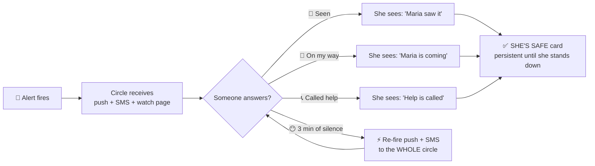
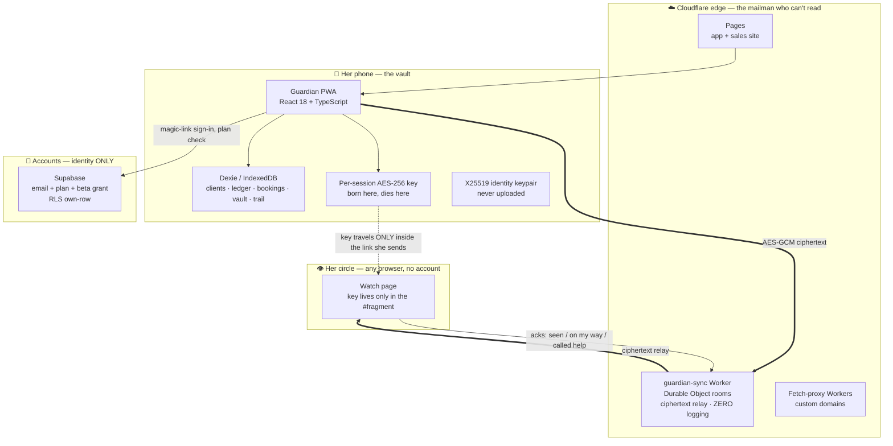
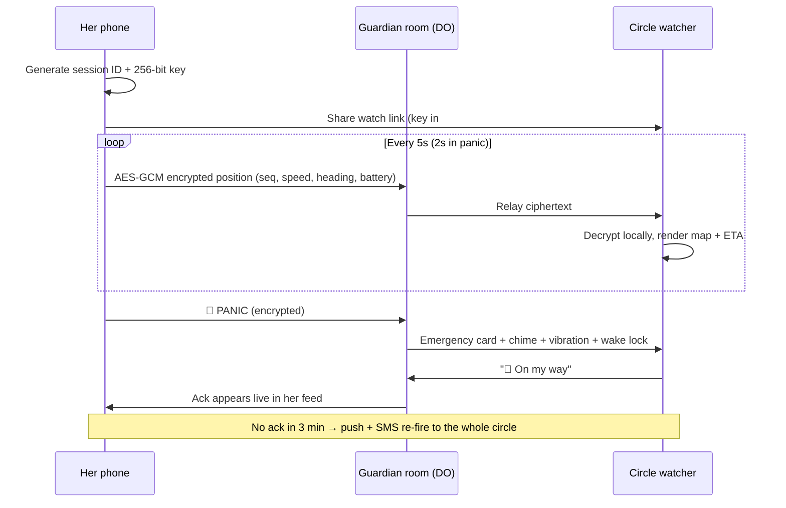
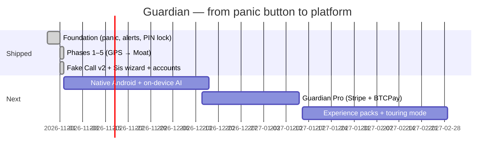

# 🛡️ G U A R D I A N

### *The bodyguard in your purse. The bouncer in your pocket. The big sister who never sleeps.*

**A safety platform engineered exclusively for in-person providers & adult entertainers —
built to a standard the billion-dollar apps never bothered to reach, because they were never built for you.**

 

 

| 🚀 **Launch the app** | 💎 **The sales site** | 📣 **Beta program** | 📖 **Full changelog** |
| :---: | :---: | :---: | :---: |
| [guardian-app.blacklisted.studio](https://guardian-app.blacklisted.studio) | [guardian.blacklisted.studio](https://guardian.blacklisted.studio) | [Read the call for testers](https://blacklisted.studio) | [CHANGELOG.md](CHANGELOG.md) |

---

> [!IMPORTANT]
> **Guardian is not a panic-button app.** Panic buttons are a commodity — a dozen apps with our name alone sell one. Guardian is a **complete safety + business operating system** for the women (and men) who meet clients in person: screening, deposits, bookings, live protected sessions, a circle that *answers back*, a fake call that *talks back*, a decoy that lies to your captor's face, and a dead-man's switch for the night everything goes wrong. Nothing else on the market ships this stack. We checked. Obsessively. It's kind of our thing.

> [!TIP]
> **New here?** Skip to [⚡ 60-Second Start](#-60-second-start) to install, or [💁‍♀️ Meet Sis](#-meet-sis--the-wizard-who-sets-you-up) for the guided tour. Developers: [🏗️ Architecture](#️-architecture--the-protocol) is where the good stuff lives.

---

## 📑 Table of Contents

- [The 10-Second Pitch](#-the-10-second-pitch)
- [Why Guardian Exists](#-why-guardian-exists--the-origin-story)
- [Who It's For](#-who-its-for)
- [⚡ 60-Second Start](#-60-second-start)
- [💁‍♀️ Meet Sis — The Wizard](#-meet-sis--the-wizard-who-sets-you-up)
- [👑 The Feature Atlas](#-the-feature-atlas)
- [📞 Fake Call v2 — The One That Talks Back](#-fake-call-v2--the-one-that-talks-back)
- [🏗️ Architecture & The Protocol](#️-architecture--the-protocol)
- [🧠 The What-If Protocols (Failsafe Bible)](#-the-what-if-protocols--the-failsafe-bible)
- [🔐 Security & Privacy Blueprint](#-security--privacy-blueprint)
- [⚔️ Guardian vs. The World](#️-guardian-vs-the-world--top-5-competitors)
- [🎁 Beta Testers Wanted](#-beta-testers-wanted--free-pro-for-a-year)
- [💎 Guardian Pro](#-guardian-pro--the-paid-tier-philosophy)
- [🗺️ Walkthroughs](#️-walkthroughs)
- [✨ Tips & Tricks](#-tips--tricks-from-the-team)
- [📈 The Evolution](#-the-evolution--zero-to-bodyguard)
- [🚀 Roadmap & Future Compatibility](#-roadmap--future-compatibility)
- [🙏 Credits — Standing on the Shoulders of Giants](#-credits--standing-on-the-shoulders-of-giants)
- [🧪 Tech Stack](#-tech-stack)
- [🏢 Who We Are](#-who-we-are)
- [❓ FAQ](#-faq)
- [📜 License](#-license)

---

## ⚡ The 10-Second Pitch

You're meeting someone you found on the internet, alone, in a place nobody knows you're going. The big safety apps want a subscription, your real name, your location history on *their* servers, and a prayer that their alert actually fires (read their reviews — bring popcorn). **Guardian gives you a protected session with military-grade encryption, a human circle that confirms they're coming, screening tools that flag the burner phone before you answer it, deposits that filter the time-wasters, and five separate ways out of a bad room** — free, account-optional, and holding custody of exactly **none** of your personal data. There is no Guardian database of your life. There can't be. We never built one.

 <i>Built for the night shift. Artwork: BNE design studio.</i>

---

## 🌑 Why Guardian Exists — The Origin Story

Guardian was born at **Blacklisted Niche Entertainment (BNE)** in Seattle, out of a simple, infuriating observation: the entire personal-safety industry builds for joggers, realtors, and worried parents — and treats in-person providers and adult entertainers, the people statistically *most* exposed to exactly the danger these apps claim to solve, as a liability to be deplatformed rather than a customer to be protected.

App stores reject their apps. Payment processors close their accounts (**63% of workers have lost a bank or payment account over their work** — FSC / SexWorkCEO, 2023). Safety apps paywall the features that matter at the moment of need, sell location data to brokers, or quietly die unmaintained, leaving the women who trusted them with a dead icon on their home screen.

So we built the thing ourselves, to the standard we'd want protecting our own people:

1. **Provider-first, not provider-tolerant.** Screening, deposits, no-show tracking, and discreet mode aren't add-ons. They're the foundation.
2. **Privacy as architecture, not as a promise.** Promises get breached. Architecture can't confess what it never collected.
3. **Safety is never paywalled.** Not during beta, not at Pro launch, not ever. The panic button is sacred.
4. **Reliability is the product.** An alert that fires "most of the time" is a decoration. Guardian is engineered — and tested, brutally, nightly — around the alert *always* firing.

Guardian started as a panic button in a browser tab. It is now, at v0.11.1, a six-phase engineering program: a GPS reliability core, a trust protocol, private encrypted infrastructure, a business suite, an AI-voiced rescue caller, and a setup wizard with more personality than most humans we know. This README is its dossier.

---

## 🎯 Who It's For

| You are… | Guardian gives you… |
|---|---|
| An **in-person provider / escort** | Screening verdicts before you reply, deposit-first bookings, protected sessions, a bad-client log that lives only on your phone |
| A **cam model doing in-person appearances** | Discreet mode (nothing on screen outs you), fake-call exits, a circle that watches without an audience |
| A **dancer / entertainer doing private parties** | Check-in/check-out escalation, dead-man's switch, safe places on the way home |
| A **masseuse, photographer, notary, realtor — anyone who meets strangers alone for money** | The same core, because danger doesn't check your job title (and our roadmap's experience packs are coming for your workflow specifically) |
| **The friend in someone's circle** | A watch link that actually shows you what's happening, buttons to say *"I'm on my way"* — and an app that nags you if nobody answers her |

---

## ⚡ 60-Second Start

> [!NOTE]
> No app store. No download queue. No account required to be protected. Guardian is a **PWA** — it installs from your browser straight to your home screen, because app stores keep rejecting apps built for this industry and we refuse to ask their permission.

| Step | Do this | Time |
|---|---|---|
| 1 | Open **[guardian-app.blacklisted.studio](https://guardian-app.blacklisted.studio)** on your phone | 5 s |
| 2 | Browser menu → **Add to Home Screen** (iPhone: Share → Add to Home Screen) | 10 s |
| 3 | Open Guardian → **Sis** (your big sister, below) walks you through everything | ~3 min |
| 4 | Start a session, share the watch link with your person, go make your money | — |

That's it. You're protected before your coffee cools.

---

## 💁‍♀️ Meet Sis — The Wizard Who Sets You Up

 <i>Sis. Older. Sassier. Has seen things. Will not let you skip the duress PIN without a speech.</i>

Most apps hand you a settings page and wish you luck. Guardian hands you **Sis**: a friendly, funny, zero-judgment big-sister guide who walks every new user through an 8-step first-run wizard — and saves your progress after every step, because setups get interrupted by life and she knows it.

| Step | Sis covers | Her energy |
|---|---|---|
| 1 · **Welcome** | What Guardian is + the privacy deal, in plain English | *"I don't do snitches. 🤐"* |
| 2 · **Free account** | Magic-link sign-in (no password!) + your beta free-year claim | *"No account = no free Pro year later. Big sister said what she said. 🤷‍♀️"* |
| 3 · **Profile** | Your name, language (EN/ES), discreet mode | Warm, two minutes, done |
| 4 · **PINs** | Main PIN (**required**), duress PIN, decoy PIN | *"It opens the app like normal… while secretly screaming for help. 😈"* |
| 5 · **Your circle** | Add at least one human — she will not let you skip this with zero | *"Nobody does this job alone, babe."* |
| 6 · **Permissions** | Location, notifications, home-screen install — with honest reasons | Zero guilt, all facts |
| 7 · **Sound & caller** | Audition the alarm sounds, pick your fake-call persona | The help-cry gets described as *"Chills. Actual chills."* |
| 8 · **Test drive** | Fires a **real test alert** to your circle, shows your protection checklist, graduates you into the guided Home tour | *"You're not on your own. Guardian's got you. And so do I. 💋"* |

Bail mid-wizard and a **"Sis is waiting"** banner on Home resumes you on the exact step. Finish it, and she never nags again. Probably.

---

## 👑 The Feature Atlas

*Everything below is live in production today — not a roadmap, not a "coming soon" page, not vapor. Version 0.11.1.*

### 🆘 Core Safety — The Non-Negotiables

| Feature | What it does | Why it's different |
|---|---|---|
| **Press-and-hold panic button** | Fires the siren, blasts an encrypted alert + live GPS to your whole circle, push + SMS layers stack automatically | Hold-to-fire kills pocket-accidents without slowing a real emergency |
| **Mandatory check-in / check-out** | Every appointment runs a timer; miss check-out and the escalation ladder starts after *your* grace period | The appointment itself is the safety device — no separate "start tracking" to forget |
| **Panic PIN lock** | The instant panic fires, every way to silence it locks behind your app PIN — including stopping the audio engine itself | An attacker holding your phone **cannot shut it up**. The duress PIN silences it — and secretly alerts your circle that you're being coerced |
| **Duress PIN** | A second PIN that unlocks the app like everything is fine… while firing a silent coercion alert with your location | For the worst sentence in the world: *"Just unlock it for me."* |
| **Decoy mode** | A **third** PIN that opens a boring fake Notes app. No Guardian. No alerts. No evidence Guardian exists | Coerced unlocks get grocery lists, not your safety system |
| **Dead-man's switch** | Optional proof-of-life timer (2–24 h). No check-in → *"Are you OK?"* → 60-second countdown → full SOS with location | For the night everything goes wrong and nobody knows yet |
| **Six alarm sounds + yours** | Police siren, piercing shriek, dual-voice BNE security warning, a research-built realistic **help cry**, air raid, klaxon — or your own audio file | The help cry was engineered from scream-perception science (roughness that recruits the amygdala) and bystander research — it says the words that make strangers act |
| **Client arrival alerts** | Send the client a discreet one-way link; get *"approaching"* / *"arrived"* geofence pings | Know he's actually here before you open the door — he never sees you |

### 📍 The Live Session — A Date, Fully Instrumented

| Layer | Engineering |
|---|---|
| **GPS engine** | Traccar-grade filter chain: 65 m accuracy gate, teleport rejection, Kalman smoothing; adaptive cadence (5 s session / 2 s panic) |
| **Encrypted sync** | Every payload AES-256-GCM; the session key exists **only** inside the watch link's URL fragment — browsers never send fragments to servers, so no server ever sees a key. Ever |
| **Guardian Cloud rooms** | Our own Cloudflare Durable Object rooms replaced the public MQTT broker (still available as fallback transport) — private infrastructure, late-joiner replay, 64 KB frame caps, **nothing logged** |
| **Offline outbox** | Composed an alert in a dead zone? It's encrypted and queued on-device, then flushed in order the second signal returns. The alert is never lost — it is *delayed at worst* |
| **Signal-interrupted detection** | If her phone goes silent >45 s mid-session, watchers see a warning — silence itself is treated as information |
| **Address-in-alerts** | Alerts carry a plain-language locality ("near Pike Place, Seattle") alongside GPS — because "47.6062, -122.3321" helps nobody at 2 a.m. |
| **Emergency A/V** | On panic, your circle can open a live WebRTC audio/video stream from your phone — peer-to-peer, signaled over the encrypted session channel |
| **Presence heartbeats** | Watchers show as *"Watching now"* — she can *see* she's not alone |

### ✅ The Confirmation Ladder — They Answer Back

The single most-loved behavior in safety research, stolen from the best and built properly: alerts aren't shouts into the void.

Plus **coded quick messages** — because sometimes you can't type: 🍕 *"I'm OK"*, 📞 *"Call me"*, 🚗 *"Come get me NOW"* (escalates the watch UI on their side), 💬 *"Just talk with me"*.

### 🔍 Screening & The Private Client Log

*The #1 practice in the community, built like it matters.*

| Tool | What it catches |
|---|---|
| **Phone intel** (libphonenumber-js) | VoIP / toll-free / burner-pattern numbers get flagged before you answer |
| **Disposable-email detection** | Full 10,115-domain snapshot runs **on-device** — the check is never logged anywhere, by design |
| **6-point screening checklist** | The community-standard verification flow, per client, saved |
| **Screenshot OCR** | Snap his booking message; Guardian extracts the number/email/handle for you to confirm — then files it (tesseract.js, on-device, lazy-loaded) |
| **Verdicts & flags** | OK / Caution / Avoid, searchable log, last-seen stamps |
| **⭐ Regulars book** | Favorite the good ones; re-contact permission tracking (not asked / yes / **never**) |
| **Follow-up flow** | A deniable, permission-based 3-step flow — thank-you → review ask → re-invite — copy-and-stamp, sent by *you* |
| **No-show counters** | Fed automatically by the booking board. His record follows him — on your phone only |

### 💼 The Business Suite — Because Safety Is a Business Problem Too

| Feature | Details |
|---|---|
| **Booking board** | Upcoming bookings with deposits; **Start** turns a booking into a protected session in two taps |
| **Deposit-first payments** | BTCPay Server invoices (self-hosted, no KYC, nobody can close it) and/or Stripe payment links; **QR codes** on invoices for in-person scans |
| **Earnings ledger** | Income / expenses / mileage, monthly totals, **CSV export for taxes** — and it *never leaves the phone*, so your books can't out you |
| **Evidence vault** | Booking screenshots and confirmations stored as on-device blobs, plus a one-tap session-journal export (your trail, your file, your call) |
| **Safe places** | Named spots you can run to; mid-session, Guardian shows the nearest one and its distance |
| **Discreet mode** | Every label in the app renames itself to innocent vocabulary — "guest log," "appointment." Nosy eyes see a scheduling app |

---

## 📞 Fake Call v2 — The One That Talks Back

Every safety app has a fake call. Ours has a **cast**.

**Phone-matched themes.** A fake call only works if it looks like *your* phone's real call screen. Pick your skin — or let Guardian auto-detect it:

| Theme | The details we sweated |
|---|---|
| **iPhone (iOS)** | Remind Me / Message row, "Accept" wording, iOS type and spacing |
| **Samsung (One UI)** | Teal wash, "Phone • Incoming call" header, Message / Remind / Block row |
| **Google Pixel** | Material pill buttons, initial-letter avatar, "Send a message" chip |
| **Classic** | The neutral Guardian original |

**A live AI caller — free, forever, on-device.** No Twilio bill, no OpenAI tab, no server: the caller runs on your phone's own built-in speech engine. She *speaks* in character, *listens* to your actual spoken replies, and answers from a branching script that routes what you say — agree, stall, question, distress, goodbye each get their own in-character lines. Mic denied? Tap-to-reply chips keep the scene alive. She is, hands down, the most committed actress in your contacts.

| Persona | The pretext | Voice |
|---|---|---|
| 👩 **Mom** | The bathroom pipe burst. There is water *everywhere*. Come home. NOW. | Warm, older, increasingly damp |
| 💅 **Jess** — bestie/roommate | The dog is sick AND she's locked out in a towel. A two-front emergency | Younger, faster, dramatic |
| 🚗 **Sis** | Her car died, her phone's at 4%, it's getting dark | Urgent, trying not to cry |
| 💼 **Dana** — the manager | Two call-outs and a walkout. She needs you at work in 20 | Brisk, professional, immovable |
| 🏠 **Mrs. Alvarez** — neighbor | Water is leaking through her ceiling — from *your* unit | Sweet, relentless |

Pick a persona in Settings (it sets the caller name automatically), schedule the call from Home — now, +5, or +10 minutes — and perform your exit. Oscar optional. Results guaranteed.

---

## 🏗️ Architecture & The Protocol

Guardian runs on infrastructure we control end-to-end, chosen so that **the system physically cannot betray its users**:

**A session, step by step:**

**Transport honesty table** — every claim, checkable:

| Claim | Mechanism | Verify it |
|---|---|---|
| Servers can't read locations | AES-256-GCM, key only in URL fragments | Fragments are never sent in HTTP requests — open your dev tools |
| Rooms log nothing | Relay code keeps last state in memory-class storage only, for late joiners | `worker-sync/` in this repo |
| No personal-data database | Clients/ledger/vault live in IndexedDB on the device | Sign in from a second phone: it's empty. That's the point |
| Accounts see only identity | Supabase schema: email, display name, plan, Stripe customer ID | `SETUP_AND_ACCOUNTS.md` in this repo |
| Push leaks nothing | ntfy pings are **content-free** — a buzz, never a location or link | `src/lib/notify.ts` |

---

## 🧠 The What-If Protocols — The Failsafe Bible

Luxury is a tailor who measured twice. Safety is an engineer who asked *"and then what?"* fifty times. Every one of these scenarios is **handled in shipped code**, not in a meeting:

| # | What if… | Guardian's answer |
|---|---|---|
| 1 | Her phone has **no signal** when she panics | The alert is composed, encrypted, and queued on-device; it fires the instant any signal returns. Nothing is composed-and-lost, ever |
| 2 | She drives **through a tunnel** mid-session | Watchers see a *signal-interrupted* warning after 45 s of silence — and the trail backfills from the on-device log |
| 3 | The attacker **grabs the phone and tries to silence it** | Panic PIN lock: every stop path routes through her PIN. The audio engine itself refuses to stop |
| 4 | He forces her to **unlock it "properly"** | Duress PIN: unlocks like normal, silently alerts the circle with her location |
| 5 | He just wants to **look through the app** | Decoy PIN opens a fake Notes app full of groceries. Guardian was never here |
| 6 | She's **incapacitated** and can't press anything | Dead-man's switch counts down from her last proof-of-life and fires the SOS itself |
| 7 | **Nobody answers** her alert | 3 minutes of silence re-fires push + SMS to the entire circle. And the watch page keeps screaming — chime, vibration, notification, wake lock |
| 8 | Her **watcher closes the tab** | Content-free ntfy push still buzzes their phone; the retained room state replays the session the moment they reopen the link |
| 9 | The **GPS drifts** in a downtown canyon | 65 m accuracy gate + Kalman smoothing + teleport rejection — the map shows her, not a teleporting ghost |
| 10 | Her **battery is dying** | Battery % rides every position frame; watchers get a low-battery warning before it becomes a silence mystery |
| 11 | The **app crashes** mid-session | Error boundaries wrap every screen; the panic banner and alarm live *outside* the boundary. A crashed screen cannot take the alarm down with it |
| 12 | She's running a **stale build** | Update toast: a one-tap "new version is ready" instead of silently running yesterday's Guardian |
| 13 | The **client no-shows** | Booking board marks it; his client-log record counts it — forever, on her phone |
| 14 | He pays with a **burner and a throwaway email** | Screening flags VoIP numbers and disposable domains on-device before she ever replies |
| 15 | She needs to **leave NOW but politely** | Fake call — scheduled or instant — with a caller who talks back (see above; Jess is *very* convincing) |
| 16 | Her **circle member is asleep** | Watch page escalates itself; missed-ack re-fire adds SMS; optional Twilio relay adds a fourth layer |
| 17 | **We get hacked** (the spicy one) | There's nothing to steal: rooms hold ciphertext in flight, accounts hold emails + plan names. Her life is on her phone, encrypted sessions end-to-end |
| 18 | **We disappear tomorrow** | Her data is already hers — on her device, exportable (vault + journal export). No hostage data, no ransom note, no "export window closes in 30 days" email |
| 19 | A **beta tester becomes a Pro subscriber** | Her beta grant is a row in her own profile: Pro through launch + 1 year, honored in data, not in a marketing email's memory |
| 20 | The **phone is stolen** mid-session | The session lives in the link her circle already holds; her PINs lock the app; her account holds nothing worth the pawn shop |

> [!WARNING]
> Guardian is a safety *system*, not a force field, and it is **not a substitute for emergency services**. If you are in immediate danger and can call your local emergency number safely, call it. Guardian's job is to make sure that if you *can't* — or if calling openly would make it worse — somebody who loves you knows exactly where you are and that you need them. Now.

---

## 🔐 Security & Privacy Blueprint

**Where every byte lives** — the entire privacy policy, in one table:

| Data | Lives | Encrypted | Who can read it |
|---|---|---|---|
| Live session positions | In flight through Guardian rooms; on-device trail | AES-256-GCM, per-session key | Only link holders (her circle) |
| Client log / screening | Her phone (Dexie) | Device storage | Her. Full stop |
| Earnings ledger | Her phone | Device storage | Her (and her tax person, via *her* CSV export) |
| Evidence vault | Her phone, as blobs | Device storage | Her |
| Bookings / safe places | Her phone | Device storage | Her |
| Account profile | Supabase (`guardian-accounts`) | TLS + RLS own-row | Her (email + plan only — there is nothing else in the row) |
| Alert push pings | ntfy topic (random, unguessable) | Content-free by design | Topic holders see a buzz. That's all a buzz contains |

**The cryptographic spine:** per-session **AES-256-GCM** keys generated on-device → **Argon2id** PIN hashing (libsodium; legacy hashes verify and migrate silently) → **X25519** device identity with sealed-box primitives ready for paired-device key delivery → **WebAuthn passkeys** as a local unlock factor, verified on-device, PIN always retained → magic-link account auth (no password database exists to breach — say it again for the breach headlines in the back).

**Threat model, stated plainly:** we defend against the curious boyfriend, the coercive client, the phone thief, the subpoena aimed at *us* (you can't produce what you don't hold), and the data broker (there is no data). We do not claim to defend against a nation-state with her unlocked phone in an evidence bag — and any app that claims otherwise is selling you a bedtime story.

---

## ⚔️ Guardian vs. The World — Top 5 Competitors

We studied the category the way you study an ex's new partner: thoroughly, and with notes. Here's the honest scoreboard.

| Capability | 🛡️ **Guardian** | Noonlight | bSafe | Life360 | Circle of 6 | VerifyHim |
|---|:---:|:---:|:---:|:---:|:---:|:---:|
| Price | **Free in beta; safety free forever** | Subscription | Subscription | Freemium + upsells | Free | Paywalled safety data |
| Built for in-person providers | **✅ It's the entire point** | ❌ | ❌ | ❌ | ❌ (campus) | ⚠️ Adjacent |
| Client screening + private bad-client log | ✅ | ❌ | ❌ | ❌ | ❌ | ⚠️ Paid lookups |
| Deposit-first bookings + payments | ✅ | ❌ | ❌ | ❌ | ❌ | ❌ |
| Circle confirms ("on my way") | ✅ + auto re-fire | ✅ ladder | ⚠️ | ⚠️ | ❌ | ❌ |
| Duress PIN (silent coercion alert) | ✅ | ❌ | ❌ | ❌ | ❌ | ❌ |
| Decoy mode | ✅ | ❌ | ❌ | ❌ | ❌ | ❌ |
| Panic PIN lock (can't be silenced) | ✅ | ❌ | ❌ | ❌ | ❌ | ❌ |
| Dead-man's switch | ✅ | ⚠️ timer apps | ⚠️ | ❌ | ❌ | ❌ |
| Fake call that **talks back** | ✅ live AI personas | ❌ | ⚠️ recording | ❌ | ❌ | ❌ |
| No central database of your life | ✅ **by architecture** | ❌ | ❌ | ❌❌ | ❌ | ❌ |
| Sells location data | **Never. There's nothing to sell** | — | — | ⚠️ ~50M users' data sold (reported) | — | — |
| Account required | **Optional** | ✅ | ✅ | ✅ | ✅ | ✅ |
| Maintenance status | **Shipped nightly** | Active | Active | Active | ⚠️ Unmaintained | Active |

**One by one:**

- **Noonlight** — the gold standard for *generic* safety, and we say so with respect: its text→call→dispatch confirmation ladder is the best behavior in the category, and we built ours in its honor. But Noonlight is a dispatch subscription for the general public. It has never screened a client, taken a deposit, or learned what a no-show costs. Guardian is the ladder — plus the entire profession around it.
- **bSafe** — feature-broad and, per its own review history, heartbreakingly unreliable ("works 10% of the time" is a *recurring theme*, not our invention). Guardian's answer is an engineering culture: offline outboxes, retained room state, silence detection, nightly live-verified deploys. Breadth without reliability is a brochure.
- **Life360** — a family tracker that reportedly sold the location data of ~50 million users. We don't have a clever line for this. We have an architecture that makes it *impossible* here: Guardian holds no location history to sell, leak, or be subpoenaed for. Their business model is your movements. Ours is your safety. Pick a side.
- **Circle of 6** — a genuinely pioneering campus app whose coded-message grammar we proudly studied. It has also been effectively unmaintained — and an unmaintained safety app is worse than none, because it *looks* like a plan. Guardian ships updates measured in days, and its update toast makes sure you actually get them.
- **VerifyHim** — screening behind a paywall, for the moment of maximum need. Guardian's screening — phone intel, disposable-email detection, checklists, verdicts — runs **on-device and free**, because a paywall between a provider and a red flag is not a business model, it's a liability waiver with a checkout button.

*And an honorable mention of genuine respect:* **National Ugly Mugs (UK)** — whose consent-first architecture ("checks are not logged") set the ethical bar our screening design follows. Not a competitor. A compass.

---

## 🎁 Beta Testers Wanted — Free Pro for a Year

> [!IMPORTANT]
> **The call is open.** We are recruiting **in-person adult entertainers and providers** to beta-test Guardian on real dates, in real life, right now.

**The deal — no fine print, because fine print is where deals go to die:**

| You do | You get |
|---|---|
| Use Guardian on your real dates | A safety system that actually shows up |
| Tell us what works, what doesn't, what should change (casually — contact options at [blacklisted.studio](https://blacklisted.studio), keyword **Guardian**) | A team that ships fixes in days, not quarters |
| Nothing else. No forms, no homework, no meetings, no "synergy" | **A FREE 1-YEAR Guardian Pro subscription the day Pro launches** — granted in your account data, not in a coupon code that expires in a junk folder |

**The privacy guarantee, architecturally:** BNE never accesses your GPS, your clients, your sessions, or your data — it all stays on your device (read the blueprint above; it's not a promise, it's a parts list). Your feedback is the only thing that ever reaches us, and only the parts you choose to send.

**Join:** install the app, let Sis set you up (she'll claim your beta status in step 2), and work a date. That's the whole application process.

---

## 💎 Guardian Pro — The Paid Tier Philosophy

When Pro launches, it will sell **convenience, scale, and luxury** — never safety:

| Always free (the sacred list) | Pro (the convenience list) |
|---|---|
| Panic, check-in/out, escalation | Multi-city touring mode |
| Duress + decoy + panic PIN lock | Advanced business analytics |
| Circle, confirmation ladder, watch pages | Priority infrastructure + concierge onboarding |
| Screening + client log | Bulk regulars tooling |
| Fake call (all personas) | Custom persona studio |
| Dead-man's switch, safe places | Expanded vault + exports |

Beta testers: your free year is already the plan of record (`pro_source = beta_grant`, expiry = launch + 1 year — stored in *your* profile row, where you can see it). Payment rails will include Stripe **and** BTCPay — because a safety company for this industry that can be deplatformed by one card processor isn't a safety company, it's a hostage.

---

## 🗺️ Walkthroughs

<b>🚶 Walkthrough 1 — Your first protected date (10 taps)</b>

| # | Tap | What happens |
|---|---|---|
| 1 | **Start appointment** (Home) | Name the date (alias only — his real name is your business), set the length |
| 2 | **Use my location** | Your incall becomes the geofence center |
| 3 | **Start** | Session key + ID are generated *on your phone* |
| 4 | **Share watch link** | Native share sheet — text it to your circle from *your* apps |
| 5 | **Check in** | Timer runs; positions stream encrypted every 5 s |
| 6 | *(during)* **Quick signals** | 🍕 OK · 📞 call me · 🚗 pick me up · 💬 talk — one tap, no typing |
| 7 | *(if needed)* **Client view** | Send him his arrival link; watch "approaching → arrived" |
| 8 | **Check out** | Ladder stands down; your circle gets the **She's Safe ✅** card |
| 9 | **Client log** | Verdict, notes, ⭐ if he was a gentleman |
| 10 | **Ledger** | Log the money. Future tax-you sends thanks |

<b>🚨 Walkthrough 2 — Panic, from her side and theirs</b>

**Her side:** press-and-hold the panic button (or miss check-out, or let the dead-man's switch lapse). Siren starts. The app locks — stopping anything requires *her* PIN. Her feed shows acks landing in real time: *"Maria saw it · Maria is on her way."* She is watching people move toward her. That matters more than we can put in a table.

**Their side:** phone buzzes (ntfy) + SMS + the watch page opens to a red emergency card: her live map, the address in words, battery, and three buttons — **Seen / On my way / Called help**. If nobody presses anything for 3 minutes, it all fires again. The watch page chimes, vibrates, and holds the screen awake until she stands down.

<b>📞 Walkthrough 3 — The graceful exit (Jess deserves an Oscar)</b>

1. Any time before the date — or mid-date, one-handed — Home → **Fake rescue call** → *Call in 5 min*.
2. Phone face-down. Conversation continues. You're a delight.
3. Your phone rings. It looks like *your* phone's real call screen (theme-matched). It's Jess.
4. Answer. She launches in: the dog, the towel, the hallway. Talk back — she listens, and she answers in character.
5. Stand up, apologetic: *"I'm so sorry, it's my roommate, there's an emergency—"* and mean it, because as far as anyone can prove, there is.
6. Leave. Your circle watched the whole thing anyway.

---

## ✨ Tips & Tricks From the Team

> [!TIP]
> **The 3-minute rule.** Before every date, spend 3 minutes: screening verdict saved, deposit confirmed, circle link sent, fake call armed at the halfway mark. Boring? Yes. That's why it works.

- 🎭 **Set your fake-call theme once** (Settings → match my phone). Auto-detect is good; *certain* is better.
- 🤫 **Duress + decoy PINs:** pick numbers you'd plausibly "mistype" under stress — never your main PIN with one digit changed.
- 🍕 **Agree the code words with your circle in person.** 🍕 means nothing until Maria knows it means *"I'm fine, stop worrying"* and 🚗 means *"stop everything and come."*
- 🔋 **Battery is a safety feature.** Below 20%, your circle gets warned — charge before the date, not during.
- ⭐ **Star your regulars** and set re-contact permission honestly. The follow-up flow prints money quietly; the "never" flag protects your peace loudly.
- 🗄️ **Screenshot everything into the vault** — booking chats, deposits, his profile — *before* the date, not after the problem.
- 🏠 **Save safe places along your actual routes**, not someday-places. The nearest-safe-place line only helps if the places are real.
- 🧪 **Use Sis's test alert monthly.** Circles drift; phones get replaced. A 10-second test beats a 2 a.m. discovery.

---

## 📈 The Evolution — Zero to Bodyguard

Six engineering phases in production, one research program that never really stops. The grease-level detail lives in [CHANGELOG.md](CHANGELOG.md) and the [v2 Blueprint](BLUEPRINT_V2.md).

| Version | Codename | What landed |
|---|---|---|
| v0.2–0.4 | *The Foundation* | Panic + check-in/out, free alert stack (share sheet + ntfy), selectable alarms, panic PIN lock, the help cry |
| v0.5.0 | **GPS Reliability Pack** | Kalman-filtered tracking, adaptive cadence, offline outbox, signal-interrupted detection, crash-proofing, test suite |
| v0.6.0 | **Trust Pack** | Confirmation ladder, She's Safe, coded signals, fake rescue call, **screening + private client log** |
| v0.7.x | **Protocol v2** | Our own encrypted Cloudflare rooms replace the public broker; Argon2id PINs; X25519 identity; passkeys |
| v0.8.x | **Face-lift** | Vector-map trial (reverted — see changelog; honesty is a feature), safety tour, EN/ES i18n, payment QR; site refresh |
| v0.9.x | **The Moat** | Regulars book + follow-up flow, booking board, earnings ledger, evidence vault, safe places, decoy mode, dead-man's switch |
| v0.10.0 | **Fake Call v2** | Phone-matched themes + the free live AI caller with 5 personas |
| v0.11.x | **Sis + Accounts** | The 8-step setup wizard; free Supabase accounts (identity + entitlement only); beta-grant plumbing for Pro |

---

## 🚀 Roadmap & Future Compatibility

**Engineering doctrine: forward-compatible or it doesn't ship.** Session payloads are versioned (v1 frames still decode), PIN hashes migrate forward silently (SHA-256 → Argon2id already happened without a single user noticing), the Dexie schema versions cleanly (v1→v4 so far, zero data loss), and the sync layer speaks two transports (our rooms + MQTT fallback) behind one interface — swap the pipes, keep the house.

| Horizon | What's coming |
|---|---|
| **Now** | Native Android build (Capacitor) with the same web core; on-device AI lane: session audio trouble-detection and voice control (panic path never depends on the AI — it *advises*, the button *decides*) |
| **Next** | Self-hosted map tiles (Protomaps PMTiles on R2) — vector maps with zero external dependency; sealed-box session keys delivered directly to paired circle devices; on-device session transcription for the vault |
| **Pro launch** | Stripe Billing + Customer Portal + BTCPay Pro rail; beta-grant backfill (free year, automatic); touring mode |
| **The vision** | **Experience packs**: the 99.9%-shared safety core, skinned and worded per profession — providers first (the flagship), then realtors, notaries, drivers, photographers, sitters. One core, battle-tested by the users with the highest stakes on Earth |

---

## 🙏 Credits — Standing on the Shoulders of Giants

Guardian was engineered by BNE — but nobody builds a cathedral alone, and we don't pretend otherwise. The open-source community unknowingly contributed patterns, algorithms, and battle-tested code to this app. **Thank you. By name:**

### 📦 Code running in Guardian today

| Project | What we took | License |
|---|---|---|
| [libsodium](https://github.com/jedisct1/libsodium) (via libsodium-wrappers) | Argon2id PIN hashing, X25519 identity, sealed boxes — our entire crypto spine | ISC |
| [Dexie.js](https://github.com/dexie/Dexie.js) | The IndexedDB layer under the client log, ledger, vault, offline outbox | Apache-2.0 |
| [driver.js](https://github.com/nilbuild/driver.js) | The guided Home tour (★27k and worth every star) | MIT |
| [libphonenumber-js](https://gitlab.com/catamphetamine/libphonenumber-js) | Phone intelligence for screening | MIT |
| [tesseract.js](https://github.com/naptha/tesseract.js) | On-device OCR for booking screenshots | Apache-2.0 |
| [i18next](https://github.com/i18next/i18next) + react-i18next | EN/ES internationalization of the safety surfaces | MIT |
| [Leaflet](https://github.com/Leaflet/Leaflet) + [OpenStreetMap](https://www.openstreetmap.org/copyright) contributors | The maps her circle watches | BSD-2 / ODbL |
| [qrcode](https://github.com/soldair/node-qrcode) | Deposit invoice QR codes | MIT |
| [mqtt.js](https://github.com/mqttjs/MQTT.js) | The fallback sync transport | MIT |
| [react-error-boundary](https://github.com/bvaughn/react-error-boundary) | Crash-proofing that keeps alarms alive outside the blast radius | MIT |
| [@supabase/supabase-js](https://github.com/supabase/supabase) | Accounts — identity + entitlement only | MIT |
| [ntfy](https://github.com/binwiederhier/ntfy) | The free, content-free push layer her circle feels buzz | Apache-2.0 / GPL-2.0 |
| [BTCPay Server](https://github.com/btcpayserver/btcpayserver) | The payment rail nobody can deplatform | MIT |
| React · Vite · Tailwind CSS · Vitest · Workbox (vite-plugin-pwa) | The skeleton, the muscles, the skin, the immune system | MIT |

### 🧭 Patterns & doctrine we studied (no code taken — respect given)

| Source | The lesson |
|---|---|
| [Traccar](https://github.com/traccar/traccar) | GPS filter-chain discipline: accuracy gates, teleport rejection |
| [Hauk](https://github.com/bilde2910/Hauk) | The expiring, self-hosted location-share model |
| kalmanjs · Turf · geolib | Smoothing, geometry, and distance math that keep the dot honest |
| [Monica](https://github.com/monicahq/monica) | The regulars-book relationship model behind our follow-up flow |
| [Ente](https://github.com/ente-io/ente) | Evidence-vault thinking: your files, your keys, your call |
| Noonlight | The confirmation ladder — the best behavior in the category (see competitors) |
| Circle of 6 | Coded-message grammar: safety you can speak in emojis |
| National Ugly Mugs | Consent architecture: checks are *not logged*, sharing is *her* decision |
| PLOS ONE provider-interview research · worker-written safety guides | The requirements document no focus group would ever give us |

If you maintain one of these projects: you helped protect people you'll never meet, in rooms you'll never see. That's not a small thing. That's the whole thing. 🖤

---

## 🧪 Tech Stack

| Layer | Choice | Why |
|---|---|---|
| App | React 18 + TypeScript + Vite 6, PWA (Workbox) | Installs anywhere, updates instantly, no store gatekeepers |
| Styling | Tailwind CSS 4 | Speed with taste |
| Local data | Dexie / IndexedDB (schema v4) | Her data, her device, versioned migrations |
| Realtime | Cloudflare Durable Objects (WebSocket rooms) + MQTT fallback | Private relay we control; zero logging |
| Crypto | WebCrypto (AES-GCM) + libsodium (Argon2id, X25519) | Boring, audited, correct |
| Accounts | Supabase Auth (magic link) + Postgres RLS | Identity only; own-row policies |
| Maps | Leaflet + OSM (PMTiles self-hosted on the roadmap) | No API keys, no watermarks, no ransom |
| Payments | BTCPay Server + Stripe | One rail they can't close, one rail everyone knows |
| Push | ntfy (content-free) + Web Notifications + optional Twilio SMS | Free first; layered always |
| Tests | Vitest — 31 tests incl. crypto round-trips & intent classification | The AES key-length bug class is *pinned by a test now* |
| Hosting | Cloudflare Pages + Workers (custom domains via worker domains) | Edge-fast, $0-to-heroic scale |

---

## 🏢 Who We Are

**Guardian is a Blacklisted Niche Entertainment (BNE) production** — engineered by **Blacklisted Binary Labs** in Seattle, Washington, under the direction of founder **Rob Branting**. BNE is the studio behind Blacklisted Binary Records, the Blacklisted design studios, and a small empire of software built for the people the mainstream platforms would rather pretend don't exist.

We are not a venture-backed safety unicorn. We are a boutique: obsessive, independent, allergic to permission. Guardian's design language — black, gold, emerald, and unapologetic — is deliberate: the women who use this app deserve software that looks like it was made by a firm that charges by the comma, because to us, *they're* the 1% worth impressing.

**Why we built it:** because "there's an app for that" was a lie told to the people who needed it most. **How it evolved:** a panic button became a protocol, the protocol became a platform, and the platform became a promise. **Where it's going:** native apps, on-device AI, profession packs, and a Pro tier that funds the mission without ever mortgaging the mission. The roadmap is above; the receipts are in the changelog; the app is live. Judge us by all three.

---

## ❓ FAQ

<b>Is Guardian really free?</b>

Yes — everything, during beta. At Pro launch, convenience features get a price tag; **safety features stay free forever**. That's not a promotion, it's the constitution.

<b>Do you have my location history?</b>

No. We *can't* — session data moves as ciphertext through relay rooms that log nothing, and everything at rest lives on your phone. There is no Guardian database of your life. We keep saying it because it's the truest sentence on this page.

<b>What does the account actually store?</b>

Email, display name, plan, and (at Pro) a Stripe customer ID. Created so your subscription — including your beta free year — has somewhere to live. Nothing else fits in the row; we designed the table that way.

<b>What if my phone dies mid-date?</b>

Your circle sees the silence, flagged as *signal interrupted* — and your dead-man's switch keeps counting. Silence in Guardian is never neutral; it's a signal with its own protocol (see the Failsafe Bible, #2 and #6).

<b>Can my client see my location from his link?</b>

No. The client link is one-way: he shares *his* approach, you share nothing back. Your watch link is a separate, encrypted channel for your circle only.

<b>Why a PWA and not the App Store?</b>

Because app stores routinely reject or bury apps built for this industry, and safety software that needs Apple's permission to exist will eventually not exist. The web installs in 30 seconds and updates instantly. Independence is a feature.

<b>I'm a developer. Can I read the interesting parts?</b>

Start with `BLUEPRINT_V2.md` (the engineering plan), `RESEARCH_V2.md` (the audience + competitor research), `SETUP_AND_ACCOUNTS.md` (the accounts architecture), `worker-sync/` (the relay), and `src/lib/` (crypto, sync, tracking, livecall). The changelog is brutally honest about what broke and why.

---

## 📜 License

Guardian is **proprietary software © Blacklisted Niche Entertainment / Blacklisted Binary Labs**. All rights reserved. The open-source components inside it remain under their respective licenses (see Credits — we honor every one of them). This repository is public so the architecture can be *audited* — trust, but verify. Especially us.

---

### 🛡️ GUARDIAN

*She was never unprotected. She was just waiting for someone to build it properly.*

**[Launch Guardian](https://guardian-app.blacklisted.studio)** · **[guardian.blacklisted.studio](https://guardian.blacklisted.studio)** · **[Join the beta](https://blacklisted.studio)**

Built with obsession in Seattle, WA · Blacklisted Niche Entertainment · Blacklisted Binary Labs
If Guardian ever matters in your life, it will be on the worst night of it. We build like we know that.

